<!--
  Perfil de Carlos Michael da Silva Sousa (github.com/Seinenk).
  Os SVGs de assets/ são animados, têm versão clara e escura e ficam parados para quem pede menos movimento.
  O cartão de atividade e a cobrinha vêm do ramo "output", atualizado todo dia pelo workflow "Perfil".
-->

<a href="https://seinenk.github.io">
  <picture>
    <source media="(prefers-color-scheme: dark)" srcset="https://raw.githubusercontent.com/Seinenk/Seinenk/main/assets/banner-dark.svg">
    
  </picture>
</a>

  <a href="https://seinenk.github.io"><picture><source media="(prefers-color-scheme: dark)" srcset="https://raw.githubusercontent.com/Seinenk/Seinenk/main/assets/selos/portfolio-dark.svg"></picture></a>
  <a href="https://www.linkedin.com/in/carlos-michael-da-silva-sousa-319370336"><picture><source media="(prefers-color-scheme: dark)" srcset="https://raw.githubusercontent.com/Seinenk/Seinenk/main/assets/selos/linkedin-dark.svg"></picture></a>
  <a href="https://www.instagram.com/carlosmichaels_/"><picture><source media="(prefers-color-scheme: dark)" srcset="https://raw.githubusercontent.com/Seinenk/Seinenk/main/assets/selos/instagram-dark.svg"></picture></a>
  <a href="http://lattes.cnpq.br/7665168854776714"><picture><source media="(prefers-color-scheme: dark)" srcset="https://raw.githubusercontent.com/Seinenk/Seinenk/main/assets/selos/lattes-dark.svg"></picture></a>
  <a href="https://orcid.org/0009-0000-8549-7762"><picture><source media="(prefers-color-scheme: dark)" srcset="https://raw.githubusercontent.com/Seinenk/Seinenk/main/assets/selos/orcid-dark.svg"></picture></a>
  <a href="mailto:carlosmaykesilva@gmail.com"><picture><source media="(prefers-color-scheme: dark)" srcset="https://raw.githubusercontent.com/Seinenk/Seinenk/main/assets/selos/email-dark.svg"></picture></a>

  

## Sobre mim

Sou **Carlos Michael da Silva Sousa**, desenvolvedor front-end e designer de UX/UI no Piauí. Toda a minha formação foi no **Instituto Federal do Piauí (IFPI)**: o curso técnico em Informática, a graduação em **Análise e Desenvolvimento de Sistemas**, concluída em 2026, e a **Residência Tecnológica em Sistemas Embarcados**.

Hoje sou **assessor técnico na Investe Piauí**, o braço de desenvolvimento do governo do estado, e **diretor de tecnologia do Ecossistema de Inovação Vale do Mel**, onde antes fui conselheiro fiscal. Também represento a comunidade de startups **Guaribas Valley**.

Gosto de projetos em que código, design e pessoas se encontram: de uma plataforma de gestão para pequenos negócios do setor alimentício ao monitoramento de abelhas sem ferrão com Internet das Coisas. Minhas pesquisas tratam de inovação e empreendedorismo.

  

**Agora**

- Assessor técnico na **Investe Piauí**, desde 2025
- Diretor de tecnologia no **Ecossistema de Inovação Vale do Mel**, desde setembro de 2026
- Representante da comunidade de startups **Guaribas Valley**
- Idiomas: português (nativo), inglês e espanhol (leio e compreendo bem)

## Trajetória

| Período | Função | Onde |
| :-- | :-- | :-- |
| 2026 — atual | **Diretor de tecnologia** | Ecossistema de Inovação Vale do Mel |
| 2025 — atual | **Assessor técnico** | Investe Piauí |
| 2025 — 2026 | Conselheiro fiscal (voluntário), até ser promovido | Ecossistema de Inovação Vale do Mel |
| 2025 — 2026 | Residente em sistemas embarcados, bolsista SOFTEX | Instituto Federal do Piauí |
| 2025 | Assistente de pesquisa e desenvolvedor front-end | Instituto de Pesquisa Econômica Aplicada (IPEA) |

**Formação**

| Período | Curso | Onde |
| :-- | :-- | :-- |
| 2025 — 2026 | Residência Tecnológica em Sistemas Embarcados (EmbarcaTech · SOFTEX), 240 h | IFPI |
| 2022 — 2026 | Tecnólogo em Análise e Desenvolvimento de Sistemas | IFPI |
| 2018 — 2020 | Técnico em Informática integrado ao ensino médio | IFPI, campus Picos |

<b>Cursos e capacitações</b>

- **Inglês para Profissionais de Desenvolvimento de TI**, IFPI (extensão, 60 h), com menção honrosa
- **Ideação no Inova Cerrado**, com o projeto BeeCerrado, Faculdade SEBRAE (60 h)
- **Sistema Eletrônico de Informações (SEI)**, ENAP (20 h)
- **Captura de Abelhas Sem Ferrão**, SENAR-DF (4 h)
- **Conect.AI: IA Generativa em Startups**, Virtus Tecnologia (4 h)

## Projetos em destaque

  <a href="https://github.com/EmilenyRochaLeal/beeSense"><picture><source media="(prefers-color-scheme: dark)" srcset="https://raw.githubusercontent.com/Seinenk/Seinenk/main/assets/projetos/bee-sense-dark.svg"></picture></a>
  <a href="https://seinenk.github.io/projetos.html"><picture><source media="(prefers-color-scheme: dark)" srcset="https://raw.githubusercontent.com/Seinenk/Seinenk/main/assets/projetos/agende-ai-dark.svg"></picture></a>
  <a href="https://github.com/Seinenk/Dino-runner"><picture><source media="(prefers-color-scheme: dark)" srcset="https://raw.githubusercontent.com/Seinenk/Seinenk/main/assets/projetos/dino-runner-dark.svg"></picture></a>
  <a href="https://github.com/Seinenk/Monitoramento_com_iot"><picture><source media="(prefers-color-scheme: dark)" srcset="https://raw.githubusercontent.com/Seinenk/Seinenk/main/assets/projetos/monitoramento-iot-dark.svg"></picture></a>
  <a href="https://github.com/Seinenk/cognitiva"><picture><source media="(prefers-color-scheme: dark)" srcset="https://raw.githubusercontent.com/Seinenk/Seinenk/main/assets/projetos/cognitiva-dark.svg"></picture></a>
  <a href="https://seinenk.github.io"><picture><source media="(prefers-color-scheme: dark)" srcset="https://raw.githubusercontent.com/Seinenk/Seinenk/main/assets/projetos/portfolio-dark.svg"></picture></a>

<b>Mais projetos</b>

- **Fábrica de Software do IFPI**: projeto de extensão que une teoria e prática; o projeto atual, Zona Azul Digital, automatiza o estacionamento rotativo de Picos.
- **INCLUA**: Plataforma de Recursos Pró-Equidade em Políticas Públicas, registrada como material didático (2025).
- **Testes de unidade com pytest**: revisão sistemática da literatura selecionada em edital de pesquisa do IFPI.
- [**Guaribas Valley**](https://github.com/Seinenk/GuaribasValleyLandingPage): página da comunidade de startups, feita em Astro.
- [**Projeto FreeRTOS**](https://github.com/Seinenk/Projeto_FreeRTOS): três tarefas que conversam por filas, no programa EmbarcaTech.
- [**Atividade multitarefas**](https://github.com/Seinenk/Atividade-multitarefas): sensores I²C e simulação de hardware na Raspberry Pi Pico.
- [**como-estou**](https://github.com/Seinenk/como-estou): rastreador de humor em Flutter, feito na disciplina de mobile.

## Conquistas

<picture>
  <source media="(prefers-color-scheme: dark)" srcset="https://raw.githubusercontent.com/Seinenk/Seinenk/main/assets/conquistas-dark.svg">
  
</picture>

- **1º lugar em Melhor Pitch** na IV Mostra Semiárido Digital, IFPI (2025)
- **Web Summit Lisboa 2025**: exposição do projeto BeeCerrado
- **Artigo**: “As barreiras impeditivas do empreendedorismo digital autônomo”, *Lumen et Virtus*, v. 17, e14746 (2026)
- **Produtos registrados**: Dino Runner (produto tecnológico) e INCLUA (material didático), ambos em 2025

<b>Eventos, feiras e exposições</b> (14)

**2026**
- 4ª Mostra Semiárido Digital (MSD IV), oficina
- Encerramento do Programa Startup Nordeste e Inova Cerrado, oficina
- Missão Técnica NEON 2026, em Maceió (AL), exposição do Agende Aí
- Startup Day 2026, exposição do Agende Aí

**2025**
- Web Summit Lisboa 2025, exposição do BeeCerrado
- 5ª Semana Nacional da Educação Profissional e Tecnológica (SNEPT), exposição do BeeCerrado
- 2º Encontro Presencial Startup Nordeste, oficina
- Palestra “Startups que transformam vidas: inovações para o Semiárido”, pela comunidade Guaribas Valley
- Startup Day Picos 2025: o Ecossistema Vale do Mel e a comunidade de startups de Picos, seminário

**2024**
- TechMeet 2024: Mambee, IA e Inovação no Desenvolvimento, seminário
- Palestra SEBRAE “Like a Boss: como transformar ideias em negócios inovadores”, seminário
- Startup Day 2024, exposição
- Palestra “Language Acquisition”, seminário

**2022**
- Apresentação da empresa Vizo, encontro

## Ferramentas do dia a dia

<picture>
  <source media="(prefers-color-scheme: dark)" srcset="https://raw.githubusercontent.com/Seinenk/Seinenk/main/assets/stack-dark.svg">
  
</picture>

Do Figma ao firmware: desenho interfaces, construo sites e aplicativos e programo sistemas embarcados.

## Atividade no GitHub

<picture>
  <source media="(prefers-color-scheme: dark)" srcset="https://raw.githubusercontent.com/Seinenk/Seinenk/output/atividade-dark.svg">
  
</picture>

<picture>
  <source media="(prefers-color-scheme: dark)" srcset="https://raw.githubusercontent.com/Seinenk/Seinenk/output/snake-dark.svg">
  
</picture>

## Fora do código

Quando não estou programando, provavelmente estou **jogando** (é meu hobby preferido, então [me chama na Steam](https://steamcommunity.com/profiles/76561198320042614/)), **assistindo** filmes, séries, animes e desenhos, ou **dormindo**, em qualquer horário do dia.

 

<a href="https://seinenk.github.io">
  <picture>
    <source media="(prefers-color-scheme: dark)" srcset="https://raw.githubusercontent.com/Seinenk/Seinenk/main/assets/rodape-dark.svg">
    
  </picture>
</a>
